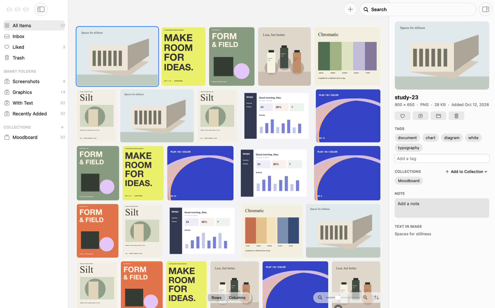

# Folio

**Fast sorting for your images and files, with search that even reads the text inside them.**

macOS 14+ · Apple Silicon + Intel · MIT License

[Demo](https://zlichtman.com/folio) · [Download](https://github.com/zlichtman/Folio/releases/latest/download/Folio.dmg) · [Report Issue](https://github.com/zlichtman/Folio/issues)



Folio is a free, open-source visual library for the Mac. Drop in images, videos and
folders, or save them from Firefox and Chrome, and Folio keeps them in one fast grid.
It tags every image and reads the text in it on your Mac, so you can find a poster by
a word printed on it, a photo by what's in it, or a screenshot by its contents.
Nothing is uploaded, and there's no account.

[Requirements](#requirements) · [Install](#install) · [Using Folio](#using-folio) ·
[Search](#search) · [Smart Folders](#smart-folders) · [Browser Extensions](#browser-extensions) ·
[Settings](#settings) · [Privacy](#privacy) · [Uninstall](#uninstall) ·
[Build From Source](#build-from-source)

## Requirements

- **macOS:** 14 Sonoma or later
- **Mac:** Apple Silicon or Intel, one universal app
- **Price:** Free and open source, no account

## Install

**Homebrew:**

```sh
brew install --cask zlichtman/tap/folio
```

You don't need `brew tap` first; installing by the full name adds
[the tap](https://github.com/zlichtman/homebrew-tap) for you.

**Download:** Get [Folio.dmg](https://github.com/zlichtman/Folio/releases/latest/download/Folio.dmg),
open it and drag **Folio** into **Applications**. It's signed with a Developer ID and
notarized by Apple.

**Updates are automatic.** Folio checks GitHub for new versions, downloads one,
checks its signature, version and that it runs on your Mac, and asks before
restarting. **Folio ▸ Check for Updates** checks right away.

## Using Folio

- **Add** files or folders with **⌘O**, by dropping them on the grid (from Finder, Photos, Messages or a browser), by pasting with **⌘V**, or from your browser's extension. A folder becomes a collection; originals stay where they are. Images, videos, GIFs, SVGs, PDFs and Illustrator files all show as pictures.
- **Watch folders** like your Desktop, Downloads or screenshots folder and Folio adds new images as they arrive and notices when files move or go away. Choose **File ▸ Watch a Folder…**, or pick one on first launch.
- **Bring a library with you**: **File ▸ Import Library…** takes an Eagle library, or any folder of folders, and makes it a collection named after it with its folders nested inside. Tags, notes and source links come along if you like. Importing the same library again fills in what's new instead of doubling it.
- **Several libraries**: keep work and personal references apart with **File ▸ Library**. New Library makes one anywhere you like, and switching reopens Folio on it. Right-click items (or use **⌘K**) to copy or move them to another library without switching; they keep their tags, notes and likes. Browser extensions stay paired whichever is open, and the `folio` command follows along.
- **Boards**: show any collection, smart folder, tag, watched folder or All Items as a board (**⌘3**) and lay it out by hand like a moodboard: drag images anywhere, resize them by the corner, bring them to the front, pinch to zoom. **Tidy Up** lays it out again. Hold Space and drag, or drag with the middle mouse button, to move around a board. Each place keeps its own layout, and a board of thousands only draws what is in view.
- **Browse** in justified rows that keep every image whole, in columns (**⌘1**, **⌘2**), as a list with names, sizes and dates (**⌘4**), handy for links, or as Infinity (**⌘5**): an endless wall of the place's pictures to wander by scrolling or dragging any way, pinching to zoom and clicking to open. Pinch, **⌘**-scroll, the slider or **⌘+**/**⌘−** change the size around the image under the pointer. Hovering shows a name, plays a GIF and plays a video (muted unless you turn sound on in Settings ▸ General, which can also make the pointer scrub instead).
- **Find anything** with the command menu (**⌘K**): commands, places, tags and items by name. **⌘J** goes straight to a collection, folder or tag, and **⌥⌘1** to **⌥⌘4** open All Items, Inbox, Liked and Trash.
- **Save links** by pasting or dropping a web address: Folio keeps a card with the page's title and preview image, or a snapshot of the page. Addresses of pictures and videos are saved as media; **⌥⌘V** keeps them as links. Paste hex codes (a palette from a design tool) or a color from a color picker and each becomes a swatch in Colors; right-click a swatch in the details panel to save it too.
- **Select** with a click, **⌘**-click, **⇧**-click, a drag across empty space, or **⌘A**. Arrow keys move around and **⇧**-arrows extend the selection.
- **Single keys** act on the selection: **T** adds tags, **C** adds to a collection, **M** moves to one, **N** writes a note, **A** the author, **U** the source, **L** likes, **S** finds similar images, **I** shows details, **R** shuffles. **⌥**-click a picture to like it without selecting it. In the tag and collection lists, Tab picks several.
- **Video frames**: in the viewer, **Item ▸ Save Frame as Picture** (**⇧⌘S**) keeps the paused frame as a picture. Right-click a picture to make it your desktop picture.
- **View** an item full size with **Return** or a double-click and page through with the arrow keys. **R** jumps to a random item. **Z** switches between Fit, Fill and 100%; pinch and drag to look closer. Settings ▸ General ▸ Viewer can hide the sidebar while you look. **Space** opens Quick Look.
- **Find Duplicates** (File menu or **⌘K**) shows exact copies together with the extra ones selected; one click moves them to the Trash and keeps the oldest of each.
- **Find Similar** (**S**, or right-click) shows the pictures, videos and link cards that look most like the one selected, by palette, composition and style, worked out on your Mac.
- **Details** on the right show the preview, tags and suggestions, the image's colors, collections, a note, the text Folio found in it, camera settings, who made it and where it came from (both editable). Click a color, or pick one anywhere on screen with the eyedropper, to find items that use it. Edits save as you type, and with several items selected, tags, collections and a note apply to all of them.
- **Filter** to images, videos, GIFs, vectors and PDFs, liked or untagged items from the bottom bar, and sort by date added, date created, name or size, shuffle, or arrange a collection by hand by dragging.
- **Right-click** an item to open it with another app, show it in its collection, copy, export or refresh its thumbnail.
- **Drag** items out to Finder or another app, onto a collection, tag or the Trash in the sidebar. Drag collections to reorder them or put one inside another.
- **Delete** moves the selection to the Trash, and **⌘Z** (or **Undo** in the notice) brings it back. Removing an item never touches the original file. In the Trash, **Put Back** restores items and **Delete** removes them for good.
- **Collections** group anything you like, and an item can be in several. Make one with the **+** in the sidebar or **⇧⌘N**; right-click it to rename, duplicate, archive or delete it. Click a sidebar section's title to fold it away, or right-click it to sort Collections, Smart Folders or Tags by name or size.
- **Themes** in Settings ▸ Appearance colour the whole window, and the Glass themes make it see-through over your desktop. The selection ring can follow your accent colour or be graphite, light grey or ink, and the grid can sit tight or airy, with square, soft or round corners.

## Search

Press **⌘F** and type. Folio searches names, tags, notes, links and the words inside
your images, and ranks the best matches first. Plain words also find related images by
meaning: "dogs on the beach" brings in pictures tagged dog and beach after the exact
matches (Settings ▸ Tagging turns this off). On Macs with Apple Intelligence, a description such
as "a warm bar interior at night" is read by the Mac's own language model, which picks the labels
that fit; nothing leaves your Mac. You can narrow a search:

| Type | To find |
|---|---|
| `tag:poster` | items with a tag |
| `type:video` | images, videos, GIFs, links, colors, SVGs, PDFs or RAW photos |
| `color:blue`, `color:#3a5ad9` or just `#3a5ad9` | items with that color in them |
| `in:Moodboard` | items in a collection |
| `is:liked`, `is:untagged` | liked or untagged items |
| `is:wide`, `is:tall`, `is:square` | pictures and videos by shape |
| `"exact phrase"`, `-word` | a phrase, or leave a word out |

## Smart Folders

Folio sorts your library automatically. **Screenshots**, **Photos**,
**Graphics**, **With Text**, **Videos**, **GIFs**, **Links**,
**Colors** and **Recently Added** fill themselves as you add things, and appear in
the sidebar once they have something in them. Rename or delete them like any collection.

Make your own with **File ▸ New Smart Folder…** (**⌥⌘N**) or the **+** beside Smart Folders:
name it, choose whether items must match all or any of its rules, and add rules for tags,
kind, name, any text, color, date added or created, liked, untagged, text in the image, shape, pixel size, file size, video length,
file type, website, collection or watched folder. The editor counts what the rules gather as you go, and
right-clicking a smart folder offers **Edit Smart Folder…** to change it later.

Tags come from Apple's on-device image classifier, plus the main colors and any text
Folio reads. You can accept suggested tags, add your own, and remove any automatic
tag for good.

## Terminal and Assistants

Folio carries a `folio` command (Settings ▸ Developers ▸ Install Command): `folio search`, `add`,
`tag`, `collect`, `similar`, `show` and `open`, with `--json` for scripts. `folio mcp` runs an MCP
server so an assistant like Claude can search your library, look at pictures, read the text in an image, tag and rename items, file
them in collections, make collections and smart folders, save links and colors, credit authors and
sources, and show a search or a place (in any layout) in Folio; it never deletes anything. Links saved this way get their titles
and previews when Folio is open. For Claude Code:

```sh
claude mcp add folio -- /Applications/Folio.app/Contents/Helpers/folio mcp
```

## Browser Extensions

**Save to Folio** works in Safari, Firefox and Chrome on the same Mac. Safari's comes
inside Folio: turn it on in Safari ▸ Settings ▸ Extensions (Settings ▸ Extensions has a
button that opens it) and allow it on 127.0.0.1. For Firefox and Chrome, install it from
the extension files in Settings ▸ Extensions. Copy the connection key from the same
place into the extension's settings, then right-click an image, video, link or page
and choose **Save to Folio**, or Option-click an image.

Folio only accepts saves from its own extensions, and only real images and videos
from the public web.

## Settings

**Settings ▸ Shortcuts** lists every menu command: click one and press new keys to change it. Hold **⌘** for a moment in the library to see the keys Folio answers to.

**Folio ▸ Settings** (**⌘,**) holds General (closing the window, the menu bar pin and the
Dock icon, the library's location), Appearance (themes, light or dark, the selection color), Shortcuts, Tagging,
Extensions, Developers, Updates and About. With the Dock icon hidden, Folio lives in the
menu bar, which keeps Settings and Show Dock Icon one click away. Files, links and colors dropped on the
menu bar pin go straight into the library.

## Backups

Folio keeps a copy of your library each day and right before anything that can't be undone:
emptying the Trash, deleting for good or importing a library. **Settings ▸ General ▸ Backups**
puts one back: Folio keeps the library as it is now as another backup, then reopens on the
one you chose. Your files themselves are never touched.

## Privacy

Everything stays on your Mac: the library, the tags, the text Folio reads and its
previews. Folio contacts the internet only to download media you save from your
browser and to check GitHub for updates. There is no account, analytics or tracking.

## Uninstall

Quit Folio and move it to the Trash, or `brew uninstall --cask folio`. Your library
stays in `~/Library/Application Support/Folio`; delete that folder to remove it too.
Thumbnails are a cache in `~/Library/Caches/org.lumashelf.app`.

## Build From Source

Swift 5.9 or later and Xcode's command line tools; no third-party dependencies.

```sh
git clone https://github.com/zlichtman/Folio.git
cd Folio
make test   # unit tests
make app    # universal, signed Folio.app staged in /private/tmp/folio-build/stage
```

`make app` signs with the "Developer ID Application" identity in your keychain;
without one, set `FOLIO_ALLOW_ADHOC=1` for a build that runs only on your Mac.
Double-click `Run Folio.command` to open the installed app, or the staged build from
a checkout. See [AGENTS.md](AGENTS.md) for the architecture and release process, and
[docs/performance.md](docs/performance.md) for benchmarks.

## License

MIT; see [LICENSE](LICENSE). Folio uses Apple's built-in image classifier and text
recognition, which are part of macOS and not distributed with this project.
